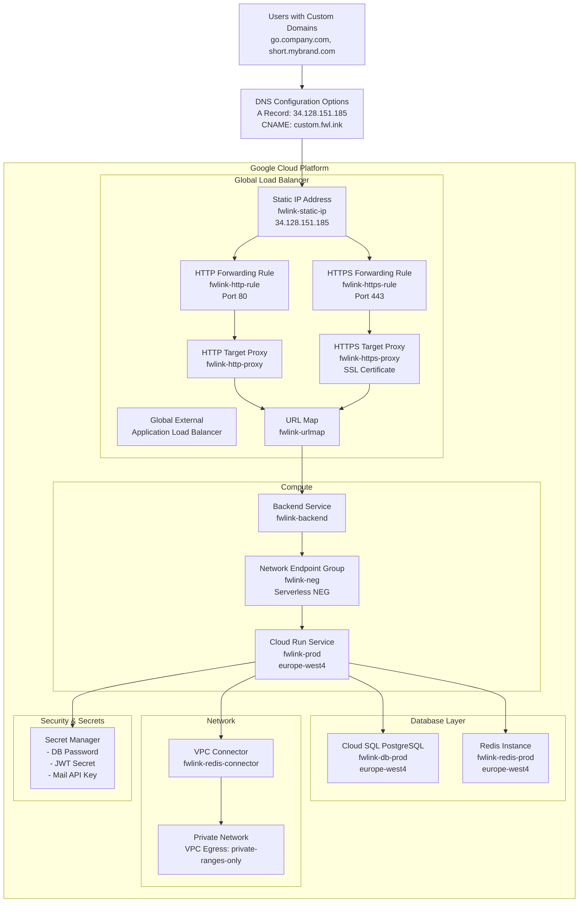
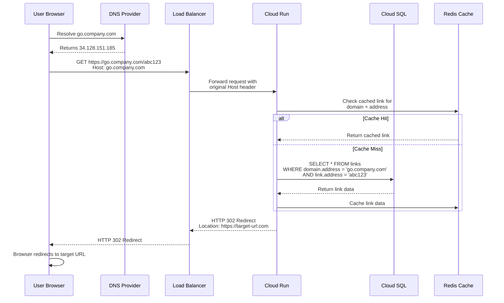
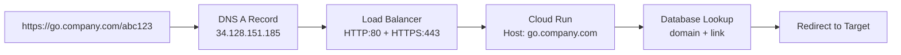
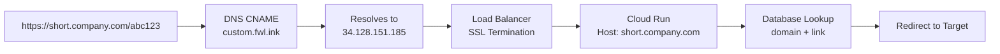
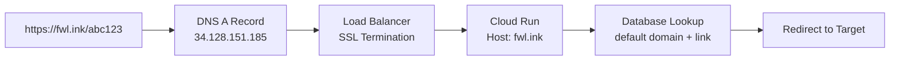
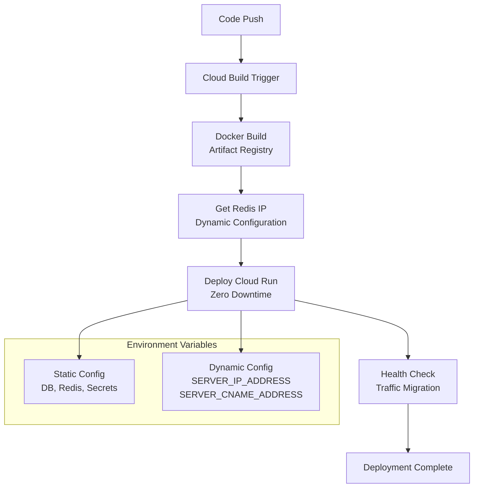

# fwLink Architecture Overview

## System Overview

fwLink is a URL shortener service deployed on Google Cloud Platform with support for unlimited custom domains. The architecture is designed to handle high traffic loads while maintaining security and scalability.

## High-Level Architecture

## Request Flow

## Google Cloud Resources

### Compute & Networking

| Resource Type | Name | Purpose | Region/Scope |
|---------------|------|---------|--------------|
| **Cloud Run Service** | `fwlink-prod` | Main application hosting | `europe-west4` |
| **Static IP Address** | `fwlink-static-ip` | Stable endpoint for DNS | Global |
| **Global Load Balancer** | Various components | Route custom domains to Cloud Run | Global |
| **HTTP Forwarding Rule** | `fwlink-http-rule` | Route port 80 traffic | Global |
| **HTTPS Forwarding Rule** | `fwlink-https-rule` | Route port 443 traffic | Global |
| **HTTP Target Proxy** | `fwlink-http-proxy` | Handle HTTP requests | Global |
| **HTTPS Target Proxy** | `fwlink-https-proxy` | Handle HTTPS requests with SSL | Global |
| **SSL Certificate** | `fwlink-ssl-cert` | SSL certificate for custom.fwl.ink | Global |
| **SSL Certificate** | `fwl-ink-ssl-cert` | SSL certificate for fwl.ink | Global |
| **URL Map** | `fwlink-urlmap` | Route requests to backend | Global |
| **Backend Service** | `fwlink-backend` | Load balancer backend config | Global |
| **Network Endpoint Group** | `fwlink-neg` | Serverless NEG for Cloud Run | `europe-west4` |
| **VPC Connector** | `fwlink-redis-connector` | Connect to Redis via VPC | `europe-west4` |

### Data Storage

| Resource Type | Name | Purpose | Region |
|---------------|------|---------|---------|
| **Cloud SQL** | `fwlink-db-prod` | PostgreSQL database | `europe-west4` |
| **Redis Instance** | `fwlink-redis-prod` | Caching and sessions | `europe-west4` |

### Security

| Resource Type | Name | Purpose | Scope |
|---------------|------|---------|--------|
| **Secret Manager** | `fwlink-db-password` | Database credentials | Project |
| **Secret Manager** | `fwlink-jwt-secret` | JWT signing key | Project |
| **Secret Manager** | `fwlink-mailgun-api-key` | Email service API key | Project |

## Traffic Flow Patterns

### 1. Custom Domain Access (A Record)

### 2. Custom Domain Access (CNAME)

### 3. Default Domain Access (fwl.ink)

## Infrastructure Security

### Network Security
- **Cloud Run Ingress**: Restricted to `internal-and-cloud-load-balancing`
- **VPC Egress**: `private-ranges-only` for database connections
- **No Public IPs**: Cloud Run instances not directly accessible

### Data Security  
- **Secret Manager**: All sensitive data stored in Google Secret Manager
- **VPC Connector**: Database connections through private network
- **SSL/TLS**: All internal communication encrypted

### Access Control
- **IAM**: Principle of least privilege for service accounts
- **Network**: Private communication between services
- **Secrets**: Automatic secret rotation capabilities

## Scalability Features

### Auto Scaling
- **Cloud Run**: 0-10 instances based on demand
- **Cloud SQL**: Connection pooling (0-10 connections)
- **Redis**: Single instance with high availability

### Performance
- **Global Load Balancer**: Worldwide edge locations
- **Redis Caching**: Fast link lookups
- **CDN Ready**: Load balancer supports Cloud CDN

### Cost Optimization
- **Serverless**: Pay per use with Cloud Run
- **Connection Pooling**: Efficient database connections  
- **Caching**: Reduced database queries

## Deployment Pipeline

## Monitoring & Observability

### Available Metrics
- **Cloud Run**: Request latency, instance count, CPU/memory usage
- **Load Balancer**: Request count, error rates, latency
- **Cloud SQL**: Connection count, query performance
- **Redis**: Memory usage, hit/miss rates

### Logging
- **Application Logs**: Cloud Run stdout/stderr  
- **Access Logs**: Load Balancer HTTP access logs
- **Audit Logs**: Google Cloud audit trail

## Related Documentation

- [Custom Domains Setup Guide](CUSTOM-DOMAINS-SETUP.md) - Detailed infrastructure setup instructions
- [Deployment Guide](fwx/INITIAL-DEPLOYMENT.md) - Initial deployment process
- [Secrets Management](fwx/SECRETS-MANAGEMENT.md) - Security configuration

## Cost Breakdown

### Base Infrastructure
| Service | Monthly Cost | Details |
|---------|-------------|---------|
| Cloud Run | $5-20 | Usage-based scaling |
| Cloud SQL | $25-50 | db-f1-micro instance |
| Redis | $30-40 | Basic tier |
| **Subtotal** | **$60-110** | |

### Load Balancer Infrastructure
| Component | Monthly Cost | Details |
|-----------|-------------|---------|
| Global External LB | $18.00 | Base monthly fee |
| Static IP Address | $0 | Free when used |
| SSL Certificates (2x) | $0 | Google-managed |
| Data Processing | $0.008/GB | After first 1TB |
| All other LB components | $0 | Included in base fee |
| **Subtotal** | **$18 + traffic** | |

### Traffic-Based Costs
| Monthly Traffic | Processing Cost | Total Monthly |
|----------------|----------------|---------------|
| < 1 TB | $0 (included) | **$78-128** |
| 1-5 TB | $8.19/TB (excess) | **$110-180** |
| 5-15 TB | Mixed rate | **$150-250** |
| 15+ TB | Volume discounts | **$200-350+** |

## Cost Optimization for Ephemeral URL Shortener

### Optimization Strategies
| Optimization | Current Cost | Optimized Cost | Savings |
|-------------|-------------|----------------|---------|
| **Regional Load Balancer** | $18/month | $8-11/month | -$7-10 |
| **Remove Redis** | $30-40/month | $0/month | -$30-40 |
| **SQLite vs Cloud SQL** | $25-50/month | $0/month | -$25-50 |
| **Smaller Cloud Run** | $5-20/month | $3-15/month | -$2-5 |

### Optimized Total Costs (Ephemeral Strategy)
| Traffic Level | Standard | Optimized | Savings |
|---------------|----------|-----------|---------|
| **Low** (< 1TB) | $78-128 | **$11-41** | **-$67-87** |
| **Medium** (5TB) | $110-180 | **$35-75** | **-$75-105** |
| **High** (15TB) | $150-250 | **$60-120** | **-$90-130** |

### Ephemeral Data Strategy Benefits
- ✅ **Auto-cleanup**: Links expire after 30 days
- ✅ **Minimal storage**: Database stays small
- ✅ **In-memory caching**: No Redis needed
- ✅ **Regional focus**: Single region deployment
- ✅ **Simplified ops**: Less infrastructure to manage

*Perfect for URL shorteners where data value decreases rapidly over time*